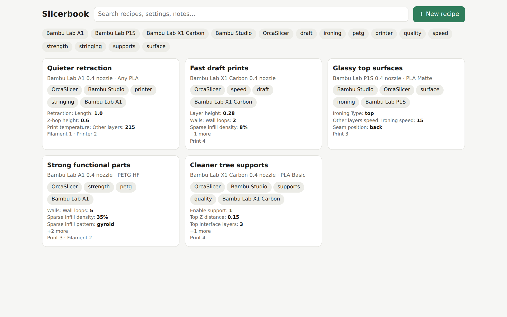
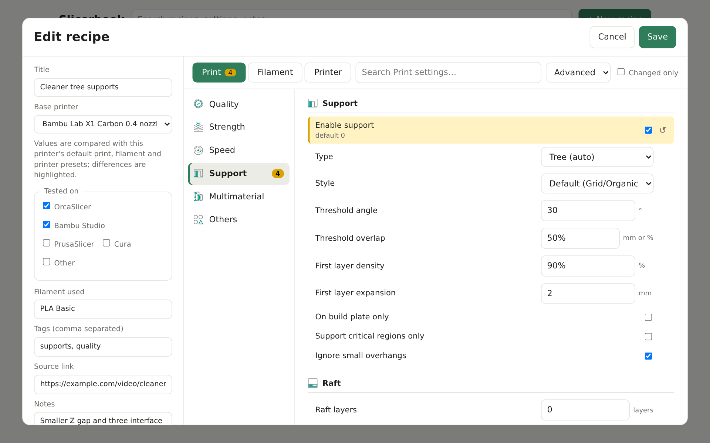
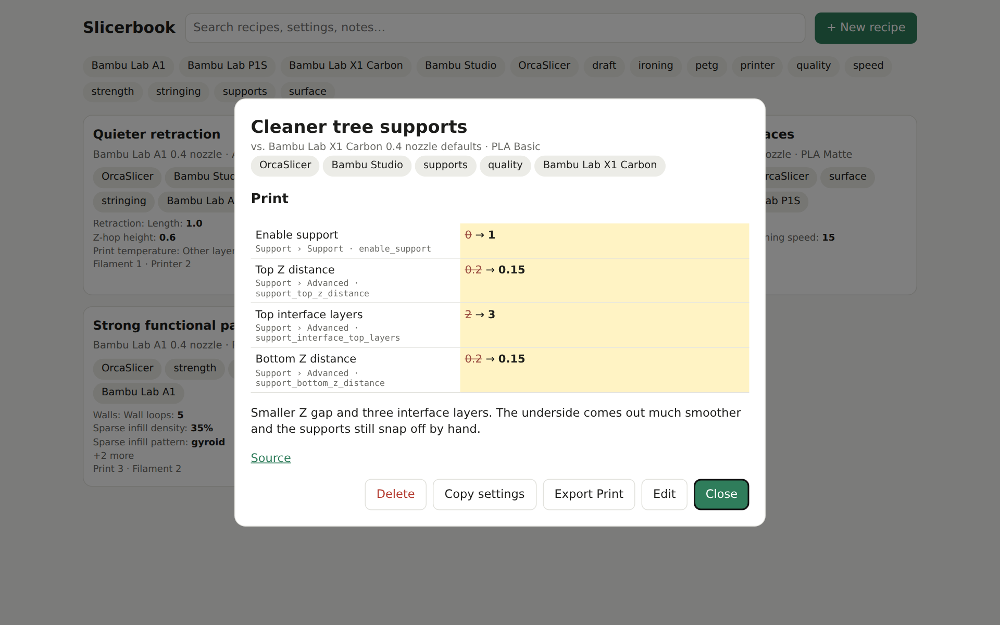

<h1 align="center">Slicerbook</h1>
<p align="center">
  A self-hosted book of the slicer settings you liked.<br>
  Save the tweak from that video once, find it again whenever you need it.
</p>

<p align="center"></p>

You watch a video that says "set the support Z distance to 0.15 and use three interface layers", and a month later
you can't remember where you put it. Slicerbook is the place to put it. Each **recipe** is a short card: what you
changed, on which printer, with which filament, why, and where you found it.

A recipe stores only what differs from your printer's defaults, so a tip is four highlighted lines instead of four
hundred keys buried in a preset. When you want it back, copy the values or export them as a preset your slicer can load.

## Features

- **Recipes, not presets.** Title, notes, photo, tags, source link, slicer, filament, and the exact setting changes.
- **A settings editor that looks like the slicer.** Print, Filament and Printer tabs with the same pages, groups and icons
  as OrcaSlicer (including the machine G-code boxes), but no model view. Simple, Advanced and Expert levels keep it uncluttered.
- **Compared with your printer's defaults.** Pick a Bambu Lab printer and every setting shows its default; the ones you
  changed are highlighted, with a reset button.
- **Import from a profile or 3MF.** Upload a project `.3mf` or a profile `.json` and keep only what differs from the
  printer's defaults (or from a baseline file you choose).
- **Export back to the slicer.** Each part (Print, Filament, Printer) exports as a user preset that inherits the
  printer's default preset.
- **Search and filter** across titles, notes, tags and the settings themselves.
- **Light and dark**, one container, SQLite, no external services.

<p align="center">
  
  
</p>
<p align="center"><sub>The editor highlights what you changed (left); a recipe shows every change next to its default (right).</sub></p>

## Run it

```sh
git clone https://github.com/edos08/slicerbook.git
cd slicerbook
docker compose up -d --build
```

Open <http://localhost:8000>. Your recipes and photos live in `./data`.

To keep the data elsewhere or change the port, edit `docker-compose.yml`:

```yaml
services:
  slicerbook:
    build: .
    ports:
      - "8000:8000"          # host:container
    volumes:
      - /path/to/appdata/slicerbook:/data
    restart: unless-stopped
```

There is **no login**. Keep it on your home network or put it behind a reverse proxy or an auth layer.

## How to use it

1. **New recipe**, give it a title and pick the printer it's for.
2. Change the settings in the Print / Filament / Printer tabs, or **import** the profile or `.3mf` you got the tip from.
3. Add a note, a photo and the source link, then save.
4. Later, open the recipe: every change is listed next to the default it replaced. **Copy settings**, or **Export** the
   Print / Filament / Printer part as a preset.

## What it covers

- **Printers:** the Bambu Lab printers shipped with OrcaSlicer (X1, P1, A1 and the others), each with its nozzle sizes.
- **Settings:** the classic ones that OrcaSlicer lays out in its tabs. Printer-specific extras (dual nozzle, resonance and
  input shaping and similar) are not included.
- **Slicers:** recipes are stored in OrcaSlicer's key names, which Bambu Studio shares for the vast majority of settings.
  A few Orca-only options don't exist in Bambu Studio.

> This is an early release. The exported presets and the 3MF import follow OrcaSlicer's formats but have not been tried
> against every slicer version. If something doesn't import, please open an issue with the file.

## Development

```sh
python -m venv .venv && . .venv/bin/activate
pip install -r requirements.txt
DATA_DIR=./data uvicorn app.main:app --reload
```

The backend is FastAPI with SQLite; the frontend is plain HTML, CSS and JavaScript with no build step.

### Settings data

`app/data/catalog.json` (pages, groups, labels, tooltips, levels, built-in defaults) and `app/data/profiles.json`
(printer defaults) are generated from an OrcaSlicer checkout, currently **v2.4.2**, along with the icons in
`app/static/icons`:

```sh
python tools/extract_catalog.py  <orca-checkout> app/data/catalog.json app/static/icons
python tools/extract_profiles.py <orca-checkout> app/data/profiles.json BBL
```

The catalog is read from `Tab.cpp` and `PrintConfig.cpp`; to cover another slicer version, point the scripts at that
checkout and regenerate.

## License and credits

Slicerbook is licensed under the **GNU Affero General Public License v3.0** (see [LICENSE](LICENSE)). It includes data and
icons derived from [OrcaSlicer](https://github.com/SoftFever/OrcaSlicer), which is also AGPL-3.0; OrcaSlicer descends
from Bambu Studio, PrusaSlicer and Slic3r. If you run a modified version as a network service, the AGPL requires you to
offer its source to your users.

Slicerbook is an independent project. It is not affiliated with or endorsed by Bambu Lab or the OrcaSlicer project, and
the names are used only to say what it works with.
